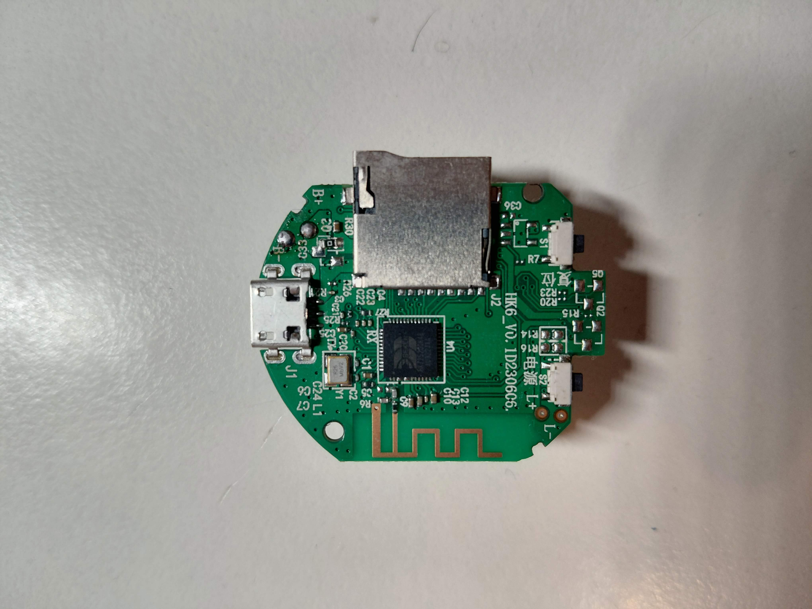
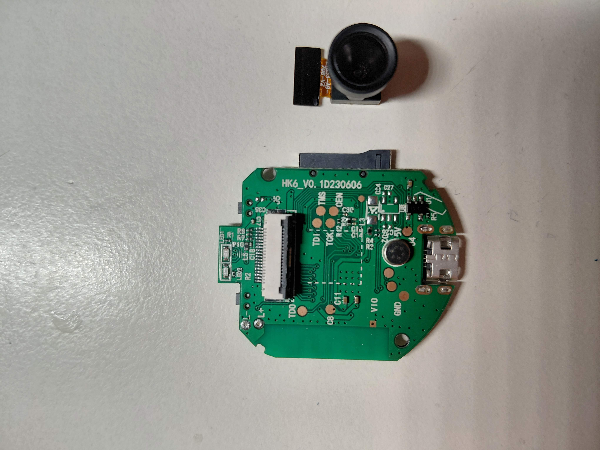
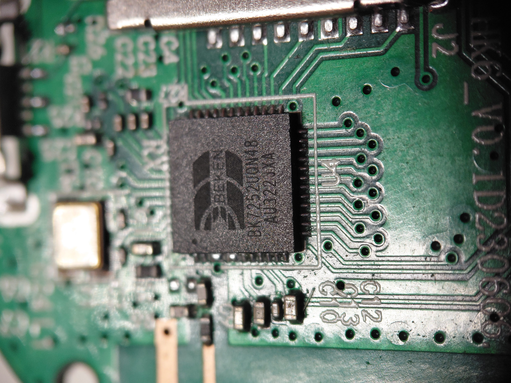
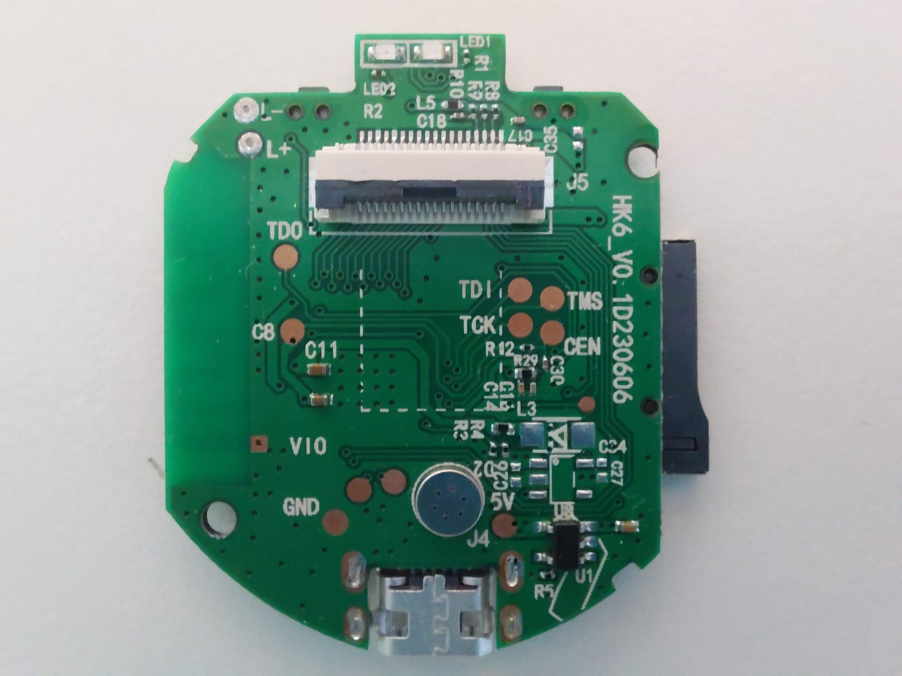

# HK6 / BK7252 — dalla camera Wi-Fi al browser

Reverse engineering e strumenti per la mini camera **HK6_V0.1D230606**, con SoC **Beken BK7252UQN48** e sensore **HI704**, originariamente utilizzata con HDWifiCamPro.

Il progetto comprende un client Python con Web UI e modifiche mirate al firmware originale per l'uso in rete locale. La versione **HTTP1**, installata e collaudata sulla nostra unità, aggiunge video HTTP direttamente dalla camera.

> Progetto sperimentale su una specifica revisione hardware. I sorgenti non sono un firmware universale per tutte le camere BK7252. APK, dump originali, credenziali, registrazioni e binari vendor non sono distribuiti in questo repository.

## Cosa funziona

| Modalità | Funzioni | Serve un computer acceso? |
| --- | --- | --- |
| Web UI Python | Live, snapshot, profili, microfono, impostazioni, configurazione Wi-Fi, archivio e player microSD, orologio e riavvio | Sì |
| Firmware HTTP1 | Pagina minima, snapshot e MJPEG direttamente dalla camera | No |

**Collaudo HTTP1:** 640×480, circa 3 fps, 363 JPEG validi in due minuti, sei riconnessioni riuscite. Un solo spettatore; video senza audio. Chrome Android, stabilità prolungata e registrazione SD contemporanea restano da verificare. [Risultati e limiti](docs/collaudo-http1.md).

L'archivio microSD supporta riproduzione, pausa e audio, con limiti di memoria. L'export AVI è ricostruito e senza audio. Cancellazione selettiva, download originale e consultazione corretta dei filmati evento richiedono altro lavoro sul firmware.

## La scheda usata nelle prove

Foto della nostra unità, fornite da Bishop87. Posizione e collegamenti valgono per questa revisione.

| SoC, antenna e microSD | Connettore camera e microfono |
| --- | --- |
|  |  |

<details>
<summary>Dettaglio della marcatura BK7252UQN48</summary>



</details>

Il sensore è stato identificato dai log `HI704 Sensor!` e dalla lettura del registro ID `0x04 = 0x96`. La sigla sul flat o la risoluzione mostrata dall'app non bastavano a identificarlo.

## Primi passi: seriale e backup

La seriale ha permesso di osservare l'avvio, identificare il sensore, leggere la flash e verificare gli aggiornamenti. Strumenti usati: adattatore FT232RL, multimetro, terminale a **115200 baud, 8N1**, senza controllo di flusso.



**Orientamento della foto:** micro-USB in basso. Chiamiamo **A** la piazzola sinistra della coppia di piazzole rotonde immediatamente a sinistra del microfono, **B** quella destra, più vicina al microfono. A/B sono nomi usati nel progetto, non serigrafie della scheda.

| Camera | Funzione verificata | Adattatore USB-seriale |
| --- | --- | --- |
| A / P11 | UART1 TX | RXD |
| B / P10 | UART1 RX | TXD, soltanto per la comunicazione bidirezionale |
| GND, verificata in continuità | Massa comune | GND |

Collegare a scheda disalimentata e usare livelli logici verificati a 3,3 V. La camera viene alimentata dal proprio ingresso: **VCC dell'adattatore non va collegato**. Per il primo ascolto bastano GND e A→RXD. Lasciare DTR/RTS scollegati. La vicinanza della scritta VIO non identifica una piazzola di alimentazione; TDI/TDO/TCK/TMS non sono etichette UART.

Prima di qualsiasi scrittura acquisire il backup della propria camera:

```sh
python3 tools/uart_backup.py --port /dev/cu.usbserial-XXXX \
  --output analysis/backups/my-camera-original
```

Lo script confronta due letture per blocco e consente la ripresa tramite checkpoint. Chiudere gli altri programmi che occupano la seriale. Non riutilizzare un checkpoint dopo un aggiornamento o con un'altra unità.

**Recupero verificato sul nostro dispositivo:** accesso al bootloader e scrittura/ripristino di un settore. Il ripristino completo dell'applicazione via UART non è stato collaudato. Possedere un dump non garantisce da solo il recupero.

## Avviare la Web UI sul computer

Python **3.10 o successivo**; il servizio applicativo usa soltanto la libreria standard. Camera e computer devono essere sulla stessa LAN. Chiudere la diretta nell'app vendor prima di creare la sessione.

```sh
git clone https://github.com/bishop87/china-cam-bk7252-hk6.git
cd china-cam-bk7252-hk6
python3 app/main.py --camera 192.168.1.54
```

Sostituire l'IP d'esempio con quello della propria camera. La password viene chiesta nel terminale senza mostrarla. Aprire **http://127.0.0.1:8765/**. Il servizio ascolta soltanto sul loopback: questa UI non è esposta agli altri dispositivi della LAN.

Per una prima acquisizione:

```sh
python3 app/main.py --camera 192.168.1.54 --snapshot /tmp/hk6-first.jpg
```

[Guida applicazione](app/README.md) · [Protocollo](app/PROTOCOL.md) · [MicroSD](app/analysis/microsd.md)

## Video diretto senza computer

**Solo se HTTP1 è già installato e verificato sulla propria camera**, aprire `http://IP_DELLA_CAMERA/` da un dispositivo sulla stessa Wi-Fi. Endpoint: `/snapshot.jpg` e `/stream.mjpg`. Lo stream è servito dalla camera, senza bridge Python.

HTTP1 non include autenticazione o TLS ed è destinato a una LAN fidata. La pagina ha riconnessione manuale. La Web UI completa e le sue impostazioni rimangono nel servizio Python.

Questo repository contiene il codice delle estensioni e gli strumenti di verifica; **non contiene un'immagine pronta da installare**. Gli installer OTA rifiutano sorgenti e pacchetti diversi dagli hash fissati. Non eliminare questi controlli per adattare una camera sconosciuta.

## Struttura

```text
app/                 Client UDP, Web UI, audio e archivio
firmware/localcam/   Prototipo alternativo da SDK, compilato ma non collaudato sulla HK6
firmware/stock-exp2/ Filtro di uscita LAN e NTP
firmware/stock-exp2b/Conversione orologio Europe/Rome
firmware/stock-http/ Estensione HTTP1: pagina, snapshot e MJPEG
tools/               Backup, analisi, build, emulazione e OTA con hash fissati
tests/               Test host e test con artefatti locali opzionali
docs/                Articolo, foto, cronologia, collaudi e istruzioni di sviluppo
```

`analysis/`, `upstream/`, `build/`, `dist/` e configurazioni locali sono esclusi da Git. Alcuni strumenti di laboratorio richiedono questi input: [sviluppo e riproducibilità](docs/sviluppo.md).

## Verifiche locali

```sh
PYTHONPATH=app python3 -m unittest discover -s app/tests -v
cc -std=c99 -Wall -Wextra -Werror -fsanitize=address,undefined \
  tests/test_stock_http.c firmware/stock-http/http.c -o /tmp/hk6-stock-http-test
/tmp/hk6-stock-http-test
```

Per la suite degli strumenti installare anche le dipendenze di sviluppo e seguire [la guida](docs/sviluppo.md), che include il modello GitHub Actions da attivare. I test che richiedono dump privati o pacchetti non distribuiti vengono saltati con una motivazione esplicita. Le prove simulate non sostituiscono il collaudo hardware.

## Il percorso del progetto

- [Articolo: dalla mini camera al browser](docs/dalla-camera-al-browser.md)
- [Cronologia delle revisioni firmware](docs/cronologia.md)
- [Studio iniziale](ANALISI.md)
- [Implementazione HTTP1](firmware/stock-http/README.md)
- [Collaudo HTTP1](docs/collaudo-http1.md)
- [Attribuzioni e componenti esterni](THIRD_PARTY.md)
- [Contribuire](CONTRIBUTING.md)

Il firmware installato conserva parti proprietarie del produttore. La pubblicazione dei sorgenti del progetto non implica una licenza sui binari vendor o sui componenti esterni; vedere le attribuzioni prima di ridistribuire.
